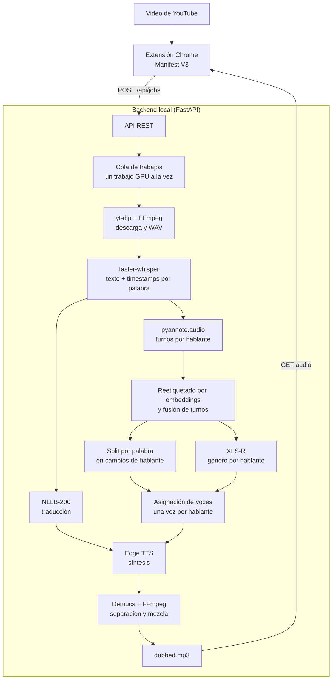

# Translate Video AI

Extensión de Chrome + backend local para **traducir y doblar videos de YouTube**.
El audio se procesa en tu equipo: se descarga de forma temporal, se transcribe,
se separan los hablantes, se traduce y se genera una pista doblada que la
extensión reproduce sobre el video original.

La diarización y la clasificación de género forman parte fija del pipeline: no
hay interruptores para desactivarlas. El backend decide la voz de cada hablante.

## Características

- Transcripción local con `faster-whisper` y timestamps por palabra.
- Diarización con `pyannote.audio`: detecta quién habla en cada
  turno y reetiqueta los turnos dudosos con embeddings de hablante.
- Clasificación de género con XLS-R: se aplica al audio
  agregado de cada hablante ya separado, no a segmentos sueltos.
- División de los segmentos de Whisper en los cambios de hablante usando los
  timestamps por palabra.
- **Una voz distinta por hablante** dentro de pools por idioma y género,
  siempre que haya voces suficientes; si se agotan, se reutilizan en orden.
- Traducción con NLLB-200 en español, inglés, francés, alemán, italiano,
  portugués, japonés y coreano.
- Síntesis con Microsoft Edge TTS.
- Ajuste automático de duración: acelera la traducción cuando no cabe en su
  hueco y la estira con moderación cuando es más corta, recortando antes el
  silencio que agrega el TTS.
- Separación de voz y música con Demucs y mezcla final con FFmpeg.
- Cola asíncrona con progreso por etapas y un único trabajo GPU simultáneo.
- Soporte para GPU NVIDIA/CUDA y para CPU.
- Interfaz de extensión en español e inglés.

## Arquitectura



### Flujo de un trabajo

1. La extensión obtiene la URL del video activo y pausa la reproducción.
2. El backend crea el trabajo y devuelve un `jobId` de inmediato.
3. `yt-dlp` descarga el audio y FFmpeg lo normaliza a WAV.
4. `faster-whisper` transcribe y guarda los timestamps por palabra.
5. `pyannote.audio` genera los turnos de cada hablante.
6. Los turnos se reetiquetan con embeddings de hablante y se fusionan los
   fragmentos consecutivos del mismo hablante.
7. Los segmentos de Whisper se parten por palabra cuando cambia el hablante.
8. XLS-R clasifica el género de cada hablante usando su audio agregado.
9. Se asigna una voz distinta por hablante dentro del pool de su idioma y
   género, con rotación para no repetir voces.
10. NLLB traduce cada segmento y Edge TTS genera los clips.
11. Demucs separa el acompañamiento y FFmpeg mezcla la voz doblada con el audio
    original.
12. La extensión consulta el progreso y reproduce el `dubbed.mp3` terminado.

## Modelos utilizados

| Componente | Modelo o motor | Función |
|---|---|---|
| Transcripción | `faster-whisper` (`tiny`, `base`, `small`, `medium`, `large-v3`) | Texto y timestamps por palabra. |
| Traducción | `facebook/nllb-200-distilled-600M` | Traducción por segmento con códigos NLLB (`eng_Latn`, `spa_Latn`, etc.). |
| Diarización | `pyannote/speaker-diarization-community-1` | Detecta los turnos de cada hablante. |
| Diarización de respaldo | `pyannote/speaker-diarization-3.1` | Se intenta si el modelo principal no puede cargarse. |
| Género de voz | `alefiury/wav2vec2-large-xlsr-53-gender-recognition-librispeech` | Clasifica el audio de cada hablante en male/female. |
| Separación | `htdemucs` (Demucs) | Separa voz y acompañamiento antes de mezclar. |
| Síntesis | Microsoft Edge TTS (`edge-tts`) | Voces neuronales por idioma. |

Todos los modelos, incluido pyannote, se descargan desde Hugging Face la primera
vez y quedan en caché. El backend **precarga al arrancar** Whisper, NLLB, Demucs,
el clasificador de género y pyannote, en un hilo aparte para que la API responda
mientras carga.

La caché completa ocupa varios GB:

| Modelo | Tamaño aproximado |
|---|---:|
| `alefiury/...-gender-recognition-librispeech` | 1,2 GB |
| `facebook/nllb-200-distilled-600M` | 2,4 GB |
| `pyannote/speaker-diarization-community-1` + dependencias | ~1 GB |
| `faster-whisper` `small` | ~0,5 GB |
| `htdemucs` | ~80 MB |

Los tamaños son orientativos: dependen del modelo Whisper elegido y de la
versión de cada repositorio.

### Selección del modelo Whisper

| Modelo | Velocidad | Precisión esperada | Uso recomendado |
|---|---:|---:|---|
| `tiny` | Muy alta | Básica | Pruebas rápidas o equipos muy limitados. |
| `base` | Alta | Buena | Equipos con poca memoria. |
| `small` | Media | Mejor | Opción predeterminada. |
| `medium` | Baja | Alta | GPU con memoria suficiente. |
| `large-v3` | Muy baja | Máxima | Cuando la calidad importa más que el tiempo. |

## Requisitos

- Windows 10/11 (las instrucciones usan PowerShell).
- Python 3.10 o superior.
- Google Chrome o un navegador basado en Chromium.
- FFmpeg disponible en `PATH`.
- GPU NVIDIA con CUDA recomendada. También funciona en CPU, pero mucho más
  lento.
- Cuenta de Hugging Face y **token de lectura**. Es necesario para descargar
  pyannote y el clasificador de género.
- Haber aceptado las condiciones de los modelos de pyannote:
  [`speaker-diarization-community-1`](https://huggingface.co/pyannote/speaker-diarization-community-1),
  [`segmentation-3.0`](https://huggingface.co/pyannote/segmentation-3.0) y
  [`speaker-diarization-3.1`](https://huggingface.co/pyannote/speaker-diarization-3.1).
- Varios GB libres en disco para la caché de modelos (≈6–8 GB según el modelo
  de Whisper elegido).

Instala FFmpeg en Windows:

```powershell
winget install Gyan.FFmpeg
```

## Instalación y ejecución

### 1. Preparar el backend

Desde la raíz del repositorio:

```powershell
python -m venv .venv
.\.venv\Scripts\Activate.ps1
pip install -r backend\requirements.txt
```

Para una instalación CUDA, instala primero las ruedas de PyTorch adecuadas
para el controlador de la máquina. El proyecto fija PyTorch `2.11.0` y
torchaudio `2.11.0`:

```powershell
pip install torch==2.11.0 torchaudio==2.11.0 --index-url https://download.pytorch.org/whl/cu128
pip install -r backend\requirements.txt
```

### 2. Configurar el entorno

Copia la plantilla a la **raíz del repositorio** (junto a `README.md`):

```powershell
Copy-Item .env.example .env
```

Edita `.env` y completa el token:

```env
HUGGINGFACE_API_TOKEN=hf_...
```

El resto de valores tiene predeterminados seguros. La sección
[Configuración](#configuración) explica las variables disponibles.

### 3. Arrancar la API

```powershell
python -m uvicorn backend.main:app --reload --port 8000
```

La primera ejecución tarda porque descarga los modelos. El progreso se ve en la
terminal (`Cargando Whisper`, `Cargando NLLB`, `Cargando Demucs`, `Cargando
clasificador de género`, `Cargando modelo de diarización`) y en la caché de
Hugging Face:

```text
%USERPROFILE%\.cache\huggingface\hub
```

Durante la descarga aparecen archivos `.incomplete`; al terminar se convierten
en los blobs definitivos. Todo, incluido pyannote, queda cargado al arrancar.


El backend detecta CUDA automáticamente. Para forzar un dispositivo:

```powershell
$env:DEVICE = "cuda"   # o "cpu"
python -m uvicorn backend.main:app --reload --port 8000
```

### 4. Activar la extensión

1. Abre `chrome://extensions`.
2. Activa **Developer mode**.
3. Pulsa **Load unpacked** y selecciona la carpeta `extension\`.
4. Abre un video de YouTube, elige idioma de origen, idioma de destino y modelo
   Whisper, y pulsa **Procesar y traducir**.

La extensión espera el backend en `http://localhost:8000`. Si cambias la
dirección, actualiza `BACKEND_URL` en `extension\background.js` y los
`host_permissions` de `extension\manifest.json`.

## Uso

1. Abre un video de YouTube y espera a que la extensión detecte la pestaña.
2. Selecciona el idioma del video, el idioma de destino y el modelo Whisper.
3. Pulsa **Procesar y traducir**. La reproducción se pausa mientras el backend
   trabaja.
4. La extensión muestra la etapa actual y el porcentaje.
5. Al terminar, el audio doblado se reproduce sobre el video original.

La voz **no se elige en el popup**: el backend la asigna automáticamente según
el hablante y su género.

### Idiomas

La interfaz ofrece estos idiomas de destino:

| Código | Idioma |
|---|---|
| `spa_Latn` | Español |
| `eng_Latn` | Inglés |
| `fra_Latn` | Francés |
| `deu_Latn` | Alemán |
| `ita_Latn` | Italiano |
| `por_Latn` | Portugués |
| `jpn_Jpan` | Japonés |
| `kor_Hang` | Coreano |

El idioma de origen admite además `jpn_Jpan` (japonés) y `kor_Hang` (coreano).

## Cómo se asignan las voces

El objetivo es que **cada persona suene distinta**, incluso si dos hablantes
comparten género:

1. pyannote detecta los turnos y les asigna etiquetas (`SPEAKER_00`,
   `SPEAKER_01`, ...).
2. Los turnos cortos o dudosos se comparan con embeddings de los turnos más
   largos de cada hablante y se reetiquetan si corresponde.
3. Los turnos consecutivos del mismo hablante se fusionan para evitar
   fragmentación.
4. Whisper entrega palabras con tiempos; cada palabra se asigna al turno que
   contiene su punto medio. Así un párrafo que mezcla pregunta y respuesta se
   parte en dos voces.
5. XLS-R clasifica el audio agregado de cada hablante (hasta 40 s en ventanas de
   5 s) y decide `male` o `female`.
6. Se recorre el pool de voces del idioma y género. La primera vez se usa la
   primera voz; si aparece otro hablante del mismo género, se usa la siguiente.
   Al agotarse el pool se reutilizan las voces en el mismo orden.

Ejemplo en español:

| Hablante | Género | Voz |
|---|---|---|
| `SPEAKER_00` | male | `es-ES-AlvaroNeural` |
| `SPEAKER_01` | male | `es-MX-JorgeNeural` |
| `SPEAKER_02` | female | `es-ES-ElviraNeural` |
| `SPEAKER_03` | female | `es-MX-DaliaNeural` |

Si un modelo no puede cargarse, el pipeline lo registra y usa la detección de
tono por segmento como red de seguridad para no perder el trabajo. El flujo normal siempre intenta pyannote y XLS-R.

## Configuración

Todas las variables se leen desde `.env` en la raíz del repositorio.

### Variables principales

| Variable | Predeterminado | Descripción |
|---|---|---|
| `HUGGINGFACE_API_TOKEN` | — | **Obligatoria.** Token de lectura para pyannote y el clasificador. También se aceptan `HF_TOKEN` y `HUGGINGFACE_HUB_TOKEN`. |
| `DEVICE` | autodetectado | `cuda` o `cpu`. |
| `WHISPER_MODEL` | `small` | Modelo usado si la petición no especifica uno. |
| `MAX_VIDEO_MINUTES` | `20` | Duración máxima aceptada, en minutos. |
| `JOBS_DIR` | `job_data` | Directorio de resultados y archivos temporales. |

### Clasificación y diarización

| Variable | Predeterminado | Descripción |
|---|---|---|
| `PYANNOTE_MODEL` | `pyannote/speaker-diarization-community-1` | Modelo principal de diarización. |
| `GENDER_MODEL` | `alefiury/wav2vec2-large-xlsr-53-gender-recognition-librispeech` | Clasificador de género. |
| `GENDER_MAX_SECONDS` | `40` | Audio máximo por hablante que se clasifica. |
| `GENDER_WINDOW_SECONDS` | `5` | Tamaño de ventana de clasificación. |
| `PYANNOTE_MIN_SPEAKERS` | — | Límite inferior de hablantes (ajuste avanzado). |
| `PYANNOTE_MAX_SPEAKERS` | — | Límite superior de hablantes (ajuste avanzado). |
| `DIARIZATION_MIN_TURN_SECONDS` | `0.4` | Duración mínima de un turno para usar su embedding. |
| `DIARIZATION_RELABEL_MARGIN` | `0.05` | Margen de similitud para reetiquetar un turno. |
| `DIARIZATION_MERGE_GAP` | `0.4` | Hueco máximo para fusionar turnos del mismo hablante. |
| `DIARIZATION_INHERIT_MAX` | `2.0` | Duración máxima que puede heredar una etiqueta cercana. |
| `MIN_SPEAKER_RUN_SECONDS` | `0.25` | Trozo mínimo de palabra para conservar un cambio de hablante. |
| `VOICE_PITCH_THRESHOLD` | `155` | Umbral de tono del respaldo de seguridad, en Hz. |

`PYANNOTE_MIN_SPEAKERS` y `PYANNOTE_MAX_SPEAKERS` son útiles cuando el público o
el ruido se detectan como hablantes. No son necesarios para el funcionamiento
normal.

### Sincronización del doblaje

Cada clip de Edge TTS se ajusta con el filtro `atempo` de FFmpeg antes de
mezclarlo:

- Si la traducción dura **más** que el hueco hasta el siguiente segmento, se
  acelera (`atempo > 1`) para que no se solape con la siguiente voz.
- Si dura **menos** que el segmento original, se ralentiza un poco
  (`atempo < 1`) para reducir el silencio, sin llegar a sonar artificial.
- Antes de medir, se recorta el silencio que Edge TTS añade al principio y al
  final del clip. Así el ajuste se calcula sobre el habla real.

| Variable | Predeterminado | Descripción |
|---|---|---|
| `DUB_MAX_TEMPO` | `1.5` | Aceleración máxima aplicada a un clip. |
| `DUB_MIN_TEMPO` | `0.85` | Ralentización máxima aplicada a un clip. |
| `DUB_MIN_SLOT_SECONDS` | `0.3` | Hueco mínimo usado para calcular el ajuste. |
| `DUB_TRIM_SILENCE` | `1` | Recorta el silencio inicial y final del TTS. |

Los clips que sigan sin caber incluso con `DUB_MAX_TEMPO` se registran en el
log y pueden solaparse levemente con el siguiente segmento. Los segmentos sin
audio TTS también se registran como advertencia para poder diagnosticar
huecos mudos.

### Rendimiento

| Variable | Predeterminado | Descripción |
|---|---|---|
| `WHISPER_COMPUTE` | `float16` en CUDA / `int8` en CPU | Tipo de cálculo de Whisper. |
| `WHISPER_BATCH_SIZE` | `16` | Lote de transcripción. |
| `WHISPER_BEAM_SIZE` | `1` | Beam size de Whisper. |
| `NLLB_BATCH_SIZE` | `16` | Lote de traducción. |
| `NLLB_BEAMS` | `2` | Beam size de NLLB. |
| `PIPELINE_WORKERS` | `8` | Hilos de preprocesamiento. |
| `TTS_CONCURRENCY` | `8` | Clips de Edge TTS en paralelo. |

`SKIP_DEMUCS=1` existe **solo para las pruebas automáticas**: omite Demucs y
mezcla la voz sin acompañamiento.

## API local

### Crear un trabajo

```http
POST /api/jobs
Content-Type: application/json
```

```json
{
  "videoUrl": "https://www.youtube.com/watch?v=...",
  "model": "small",
  "sourceLanguage": "eng_Latn",
  "targetLanguage": "spa_Latn"
}
```

Respuesta `202`:

```json
{
  "jobId": "c823...",
  "status": "queued",
  "stage": "queued",
  "progress": 0.0
}
```

El campo `voice` es opcional y está pensado para integraciones que quieran
forzar una voz concreta de Edge TTS; la extensión nunca lo envía. Cuando se
indica, el backend comprueba que el prefijo corresponda al idioma de destino
(por ejemplo `es-` para español) y devuelve `400` si no coincide. Para japonés y
coreano no hay prefijo definido, así que esa comprobación no se aplica.

Errores habituales:

- `400`: la URL no es de YouTube, el modelo no está permitido o el idioma no
  está soportado.
- `404`: el `jobId` no existe.

### Consultar el estado

```http
GET /api/jobs/{jobId}
```

Las etapas reportadas son `download`, `transcription`, `diarization`, `voices`,
`translation`, `tts`, `separation` y `mixing`. Los estados posibles son
`queued`, `processing`, `completed` y `failed`; en caso de fallo, el campo
`error` contiene el mensaje.

Al completarse, la respuesta incluye además `audioUrl`, `translation` y
`segments`. Cada segmento lleva `start`, `end`, `text`, `text_translated`,
`speaker`, `gender` (`male`/`female`) y `tts_voice`, lo que permite auditar qué
voz se asignó a cada hablante.

### Descargar el audio

```http
GET /api/jobs/{jobId}/audio
```

Devuelve `dubbed.mp3` cuando el trabajo está `completed`.

## Estructura del proyecto

```text
translate-video-ai/
├── backend/
│   ├── main.py             # API FastAPI y validación de peticiones
│   ├── jobs.py             # Cola en memoria y estados de trabajos
│   ├── pipeline.py         # Descarga, IA, TTS, mezcla y limpieza
│   ├── requirements.txt    # Dependencias Python
│   └── .env.example        # Plantilla de configuración
├── extension/
│   ├── manifest.json       # Configuración Manifest V3
│   ├── popup.html/js       # Interfaz de selección y controles
│   ├── background.js       # Comunicación con FastAPI y polling
│   └── content.js          # Integración con la pestaña de YouTube
├── job_data/               # Resultados temporales (ignorado por Git)
├── .env                    # Configuración local (ignorado por Git)
├── .env.example            # Plantilla de configuración
├── LICENSE                 # Licencia Apache 2.0
└── README.md
```

## Licencia

Este proyecto se distribuye bajo la licencia [Apache License 2.0](./LICENSE).
Consulta el archivo `LICENSE` para conocer los términos completos.
